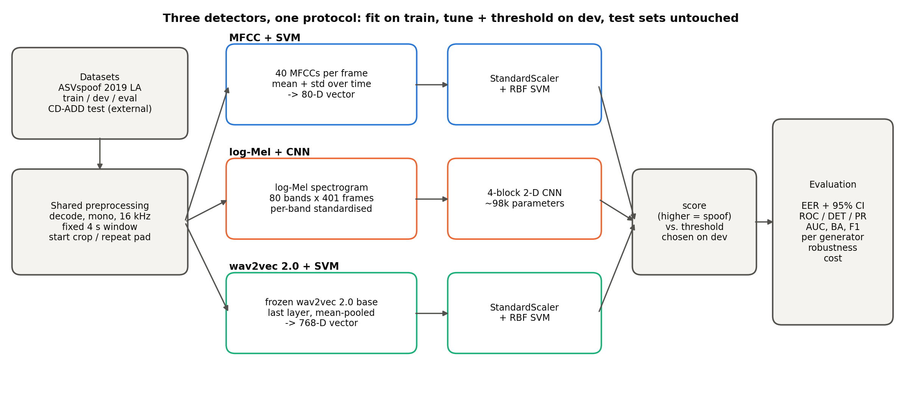
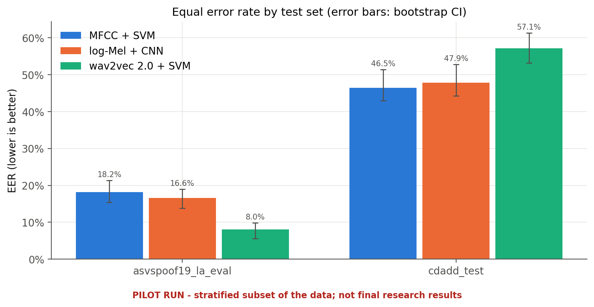
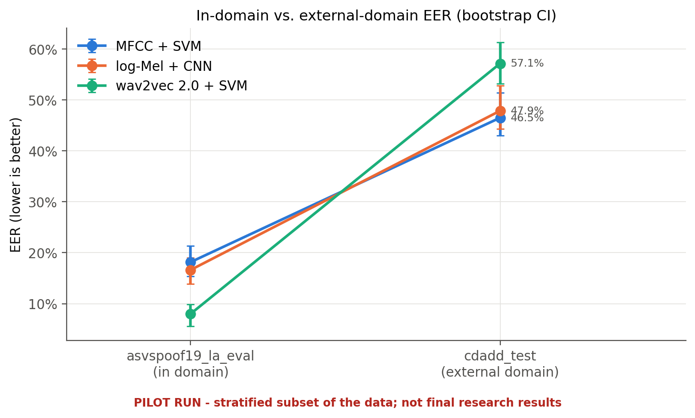
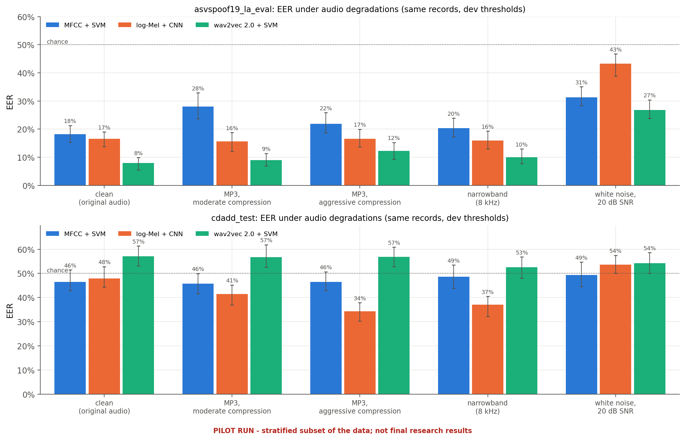
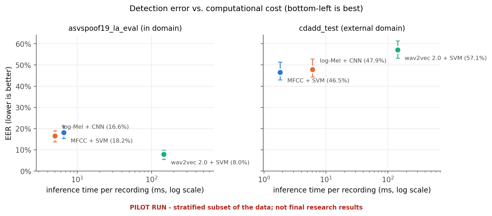

# Robust Detection of AI-Generated Speech

### A comparative study of classical features, deep learning, and pretrained speech representations

This project compares three approaches for distinguishing genuine human speech (class 0, *bona fide*) from AI-generated or manipulated speech (class 1, *spoof*). It focuses on whether systems trained on known examples generalise to recordings from unfamiliar speech-generation systems and to degraded audio (MP3 compression, telephone bandwidth, noise). The research question is not new; the contribution is a reproducible, like-for-like comparison under in-domain, cross-domain and degraded-audio conditions.

| Solution | Audio representation | Classifier | Purpose |
| --- | --- | --- | --- |
| 1 | MFCC mean/std statistics | RBF-kernel SVM | Classical, computationally light baseline |
| 2 | Log-Mel spectrograms | Compact 2-D CNN | Learn time-frequency patterns from audio |
| 3 | Frozen wav2vec 2.0 embeddings (mean-pooled) | RBF-kernel SVM | Evaluate transfer-learned speech representations |



## Status

All three pipelines, the data layer, the evaluation, the robustness study, the figures and the report generator are implemented and covered by tests, including an end-to-end synthetic smoke test. A **demo (pilot) run** on stratified subsets of the real datasets has been trained and evaluated: 600 train / 600 dev / 625 eval ASVspoof 2019 LA clips and 796 CD-ADD clips. Its numbers are labelled PILOT everywhere; they demonstrate the pipeline and are not final research results. The full-scale run uses the same commands with `configs/default.yaml`.

## Results at a glance (demo run)

| | MFCC + SVM | log-Mel + CNN | wav2vec 2.0 + SVM |
|---|---|---|---|
| dev EER (used for tuning) | 14.33% | 4.67% | 5.67% |
| **EER, ASVspoof 2019 LA eval** (in domain, unseen attacks) [95% CI] | 18.15% [15.4, 21.3] | 16.62% [13.8, 19.0] | **8.00% [5.6, 9.9]** |
| ROC-AUC / balanced accuracy, in domain | 0.906 / 83.3% | 0.911 / 81.4% | **0.978 / 92.0%** |
| **EER, CD-ADD test** (external, newer TTS systems) | 46.49% | 47.86% | 57.14% |
| EER in domain, MP3 ~25 kbps / narrowband / 20 dB noise | 21.9 / 20.3 / 31.3% | 16.6 / 16.0 / 43.3% | 12.3 / 10.0 / 26.8% |
| trained parameters | 277 support vectors | 97,650 weights | 258 support vectors (+ 95 M frozen) |
| training time / inference per recording | 0.01 s (+4 s features) / 4.2 ms | 196 s / 5.5 ms | 0.04 s (+88 s features) / 145 ms |

**Findings.** In domain, wav2vec 2.0 + SVM is clearly best: its confidence interval does not overlap the others'. On the external CD-ADD set all three models are at or below chance, so none generalises to the newer zero-shot TTS systems. Compression and bandwidth limits cost little; additive noise hurts every model.

| | |
|---|---|
|  |  |
|  |  |

## Where to find things

| Folder | Contents |
|---|---|
| [`results/`](results/) | **All results**: [final_report.md](results/final_report.md) (combined report), `figures/` (34 graphs), `tables/` (CSV metric tables) and `run_data/` (raw per-run predictions, metrics, splits and logs the report is built from) |
| [`docs/`](docs/) | **All documentation**: [case study and problem definition](docs/CaseStudy_ProblemDefinition.md), the three solution documents with their results ([Solution 1](docs/Solution1_MFCCFeatures+SVM.md) · [Solution 2](docs/Solution2_Log-MelSpectrogram+CNN.md) · [Solution 3](docs/Solution3_wav2vec2.0Embeddings+SVM.md)), [methodology](docs/methodology.md), [dataset setup](docs/dataset_setup.md), [team work split](docs/team_work_split.md) |
| `src/speechdeepfake/` | the Python package (CLI `speechdeepfake`) |
| `configs/` | `demo.yaml` (demo run), `default.yaml` (full run), `quick_test.yaml` (pilot + smoke-test settings) |
| `tests/`, `scripts/` | unit / end-to-end tests; helper scripts |
| `data/`, `models/` | datasets and trained models (git-ignored, regenerable) |

## Experimental design

- **Train:** official ASVspoof 2019 LA training partition. **Validation:** official LA development partition, used for SVM hyperparameters, CNN checkpoint selection/early stopping, and the operating threshold.
- **In-domain test:** official LA evaluation partition (keys ship with the database).
- **External test:** CD-ADD `test` split (LibriTTS test-clean + TED; OpenVoice, VALL-E, WhisperSpeech, YourTTS, Seamless). Never used for fitting, scaling, tuning or thresholds.
- **Robustness:** the trained models re-score MP3 (~80 and ~25 kbps), 8 kHz narrowband and 20 dB-noise copies of every test recording, with unchanged dev thresholds.
- Same preprocessing (16 kHz mono, fixed 4 s window, deterministic evaluation crop) and the same evaluated records for all three models.
- Metrics: accuracy, balanced accuracy, precision, recall, F1, ROC-AUC, average precision, EER (with cluster-bootstrap CIs), ROC/DET/PR curves, confusion matrices, score distributions, per-generator and per-source-domain EER, training/feature/inference time and model size.

Details: [docs/methodology.md](docs/methodology.md).

## Installation

Python 3.10–3.12 in a virtual environment.

```bash
# bash / Git Bash
python -m venv .venv
source .venv/Scripts/activate        # Windows Git Bash; on Linux/macOS: source .venv/bin/activate
pip install -e ".[dev]"
```

```powershell
# Windows PowerShell
python -m venv .venv
.\.venv\Scripts\Activate.ps1
pip install -e ".[dev]"
```

**GPU (recommended for wav2vec 2.0 extraction and CNN training).** `pip` installs the CPU build of PyTorch by default. If you have an NVIDIA GPU, install a CUDA build first, e.g. `pip install torch --index-url https://download.pytorch.org/whl/cu126`, then check with `speechdeepfake inspect` (`"cuda_available": true`). Everything also runs on CPU, only slower. On the development laptop's CPU, wav2vec 2.0 extraction took about 0.15–0.25 s per 4 s clip.

## Reproducing the demo run (~300 MB, under an hour on a CPU laptop)

```bash
speechdeepfake download-subset --config configs/demo.yaml   # stratified subsets via HTTP range requests
speechdeepfake prepare-data    --config configs/demo.yaml
speechdeepfake validate-data   --config configs/demo.yaml
speechdeepfake run-all         --config configs/demo.yaml   # train + evaluate + figures + report
speechdeepfake robustness      --config configs/demo.yaml   # MP3 / narrowband / noise study (~20 min on CPU)
speechdeepfake report          --config configs/demo.yaml   # rebuild figures and results/final_report.md
```

`download-subset` never downloads the full archives: it reads only the needed parts of `LA.zip` and a few 100-row blocks of each CD-ADD parquet shard. The exact selection is recorded in `data/raw/*/SUBSET.json`.

## All commands

All commands accept `--config` (default `configs/default.yaml`) and `--help`. The syntax is identical in bash and PowerShell.

| Step | Command |
|---|---|
| Environment and hardware | `speechdeepfake inspect --config configs/default.yaml` |
| Which datasets are present | `speechdeepfake check-data` |
| Download (explicit only) | `speechdeepfake download --dataset asvspoof2019_la` · `speechdeepfake download --dataset cdadd` |
| Build manifests | `speechdeepfake prepare-data` |
| Validate audio, labels, leakage | `speechdeepfake validate-data` |
| Software smoke test (synthetic, output in the system temp folder) | `speechdeepfake smoke-test --config configs/quick_test.yaml` |
| Cache features | `speechdeepfake extract-features --model all` |
| Train one model / all | `speechdeepfake train --model mfcc_svm` · `logmel_cnn` · `wav2vec_svm` · `all` |
| Resume interrupted CNN | `speechdeepfake train --model logmel_cnn --resume` |
| Evaluate (same test records) | `speechdeepfake evaluate-all` |
| Robustness to audio degradations | `speechdeepfake robustness [--model ...] [--force]` |
| Figures only | `speechdeepfake plots` |
| Figures + Markdown report | `speechdeepfake report` |
| Everything after validation | `speechdeepfake run-all` |
| Whole pipeline (script) | `python scripts/run_all_experiments.py --config configs/default.yaml --robustness` |

Tests: `pytest` (all) or `pytest -m "not slow"` (skip the end-to-end test).

## Tested environment

Windows 11, Python 3.12.9, numpy 1.26.4, scipy 1.15.1, pandas 2.3.3, scikit-learn 1.7.2, librosa 0.11.0, soundfile 0.13.1 (libsndfile 1.2.2, used for MP3 encoding), torch 2.8.0 (CPU build), transformers 4.41.2, pyarrow 23.0.1, matplotlib 3.10.7, PyYAML 6.0.2, pytest 8.4.2. Not yet tested: CUDA execution, Linux/macOS.

## Team

| Member | Name | Responsibility |
|---|---|---|
| 1 | Lakshya Upadhya | Dataset and preprocessing |
| 2 | Arnav Karwa | Solution 1: MFCC + SVM |
| 3 | Bhavya Shah | Solution 2: log-Mel + CNN |
| 4 | Krish Lodha | Solution 3: wav2vec 2.0 + SVM, evaluation, robustness and integration |

Module ownership and interfaces: [docs/team_work_split.md](docs/team_work_split.md).

## References

Li et al. (2024), *Cross-Domain Audio Deepfake Detection: Dataset and Analysis*, EMNLP 2024 · ASVspoof 2019 (Todisco et al., Interspeech 2019; database doi:10.7488/ds/2555) · Baevski et al. (2020), *wav2vec 2.0*, NeurIPS 2020 · Gao et al. (2021), *Generalized Spoofing Detection Inspired from Audio Generation Artifacts*, Interspeech 2021 · Müller et al. (2021), *Speech is Silver, Silence is Golden*. Full list in the [final report](results/final_report.md).
