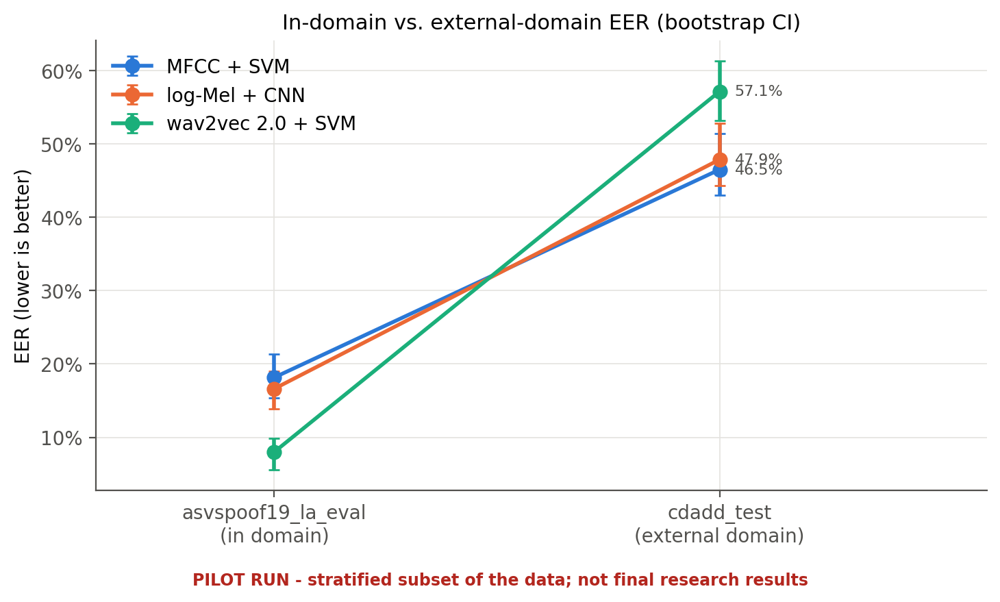

# Robust Detection of AI-Generated Speech
### A Pattern Recognition Study of Generalization Across Unseen Speech-Generation Systems

## 1. Background and Problem Statement

Advances in text-to-speech (TTS) and voice-cloning technology make it possible to generate convincing human-like speech. Although these technologies have legitimate applications, synthetic speech can also be misused for impersonation, financial fraud, fabricated recordings, and misinformation. The FBI has specifically warned about the use of generative AI to facilitate financial fraud.

Audio deepfake detection aims to classify an audio recording as genuine human speech or synthetic/manipulated speech. However, a model trained on a limited collection of voice-generation systems may fail when exposed to unfamiliar generators, compression, or different recording conditions.

This case study investigates the effectiveness of three pattern-recognition approaches for detecting AI-generated speech, with particular emphasis on generalization beyond the speech-generation patterns encountered during training.

## 2. Aim and Objectives

- Develop three classifiers for distinguishing genuine from AI-generated speech.
- Compare handcrafted acoustic features, learned spectrogram features, and pretrained speech representations.
- Measure classification performance using consistent evaluation metrics.
- Investigate generalization to an independent dataset containing newer speech-generation systems.
- Compare the approaches in terms of predictive performance, computational cost, and practical limitations.

## 3. Proposed Methodology

The project will implement the following approaches:

1. MFCC Features + Support Vector Machine (SVM).
2. Log-Mel Spectrogram + Convolutional Neural Network (CNN).
3. Pretrained wav2vec 2.0 Embeddings + SVM.

The primary training and validation source will be the ASVspoof 2019 Logical Access (LA) dataset, using its official training and development partitions. The official evaluation partition will be kept separate for final in-domain evaluation.

The CD-ADD dataset, which includes speech generated by five advanced zero-shot TTS systems, will be used as an independent external test wherever its evaluation protocol and available metadata permit. Its test data will not be used for model fitting or hyperparameter tuning.

Audio preprocessing and class definitions will be kept consistent across approaches. Where feasible, the experiment will also examine how audio compression affects detection performance.

## 4. Evaluation and Expected Deliverables

The models will be evaluated using Equal Error Rate (EER), precision, recall, F1-score, accuracy, ROC-AUC, and confusion matrices. EER and ROC curves will provide useful comparisons of detection behaviour across decision thresholds.

The project will produce three trained classifiers, implementation code, visualizations, and a comparative report. Results will be reported separately for the benchmark evaluation set and the independent external test set.

The expected contribution is an experimental comparison of three pattern-recognition approaches, including an investigation of whether their performance changes when evaluated on speech from different generation systems. No performance improvement will be assumed before the experiments are conducted.

## 5. Outcome (demo run)

All three classifiers, the evaluation and the compression study have been implemented and run end to end on stratified subsets of the data (pilot run; not final research results). Full details: [final report](../results/final_report.md) and the per-solution reports ([Solution 1](Solution1_MFCCFeatures+SVM.md) · [Solution 2](Solution2_Log-MelSpectrogram+CNN.md) · [Solution 3](Solution3_wav2vec2.0Embeddings+SVM.md)).

| | MFCC + SVM | log-Mel + CNN | wav2vec 2.0 + SVM |
|---|---|---|---|
| EER, ASVspoof 2019 LA eval (in domain, unseen attacks) | 18.15% | 16.62% | **8.00%** |
| ROC-AUC, in domain | 0.906 | 0.911 | **0.978** |
| EER, CD-ADD (external, five newer TTS systems) | 46.49% | 47.86% | 57.14% |
| EER in domain under 20 dB noise / ~25 kbps MP3 | 31.3% / 21.9% | 43.3% / 16.6% | 26.8% / 12.3% |
| inference time per recording | 4.2 ms | 5.5 ms | 145 ms |

Answers to the case-study questions:

- **Which approach detects best?** In domain, frozen wav2vec 2.0 embeddings + SVM, by a margin larger than the confidence intervals.
- **Does it generalise to unseen generation systems?** Within ASVspoof's unseen attacks, partly: A17–A19 remain hard for every model. On CD-ADD's newer zero-shot TTS systems, no: all three models are at or below chance. This is the main finding, and it matches the motivation of the study.
- **Effect of compression and channel conditions:** moderate MP3 and narrowband cost at most a few EER points for wav2vec 2.0 + SVM and the CNN. Additive noise hurts every model, the CNN most, and it shifts the scores so the dev-selected thresholds stop working.
- **Cost:** MFCC + SVM and the CNN run in a few milliseconds per recording; wav2vec 2.0 costs about 30× more.

## 6. References

1. Li, Y. et al. (2024). "Cross-Domain Audio Deepfake Detection: Dataset and Analysis." Proceedings of EMNLP 2024, pp. 4977–4983.
   https://aclanthology.org/2024.emnlp-main.286/

2. ASVspoof 2019. "Automatic Speaker Verification Spoofing and Countermeasures Challenge: Evaluation Plan."
   https://www.asvspoof.org/asvspoof2019/asvspoof2019_evaluation_plan.pdf

3. Federal Bureau of Investigation, Internet Crime Complaint Center (2024). "Criminals Use Generative Artificial Intelligence to Facilitate Financial Fraud."
   https://www.ic3.gov/PSA/2024/PSA241203