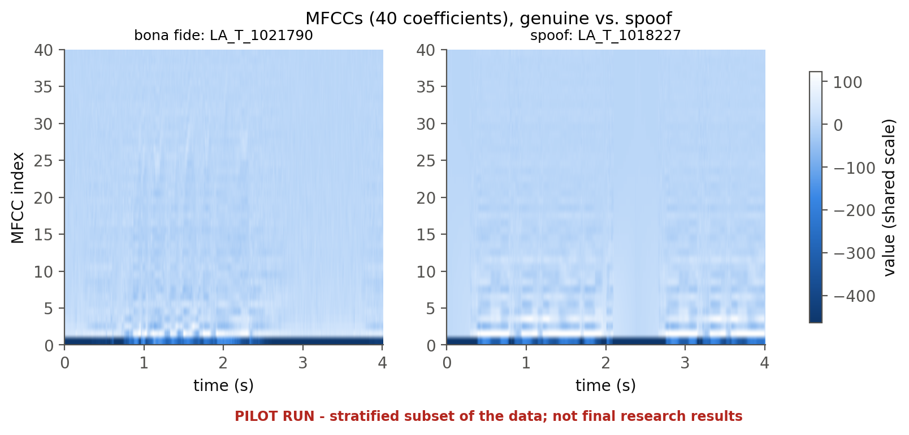
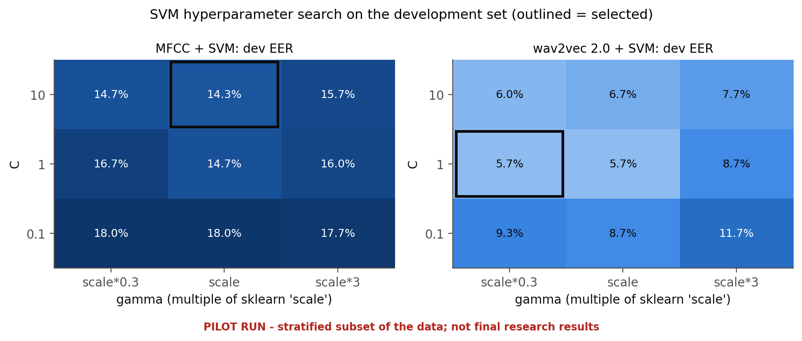
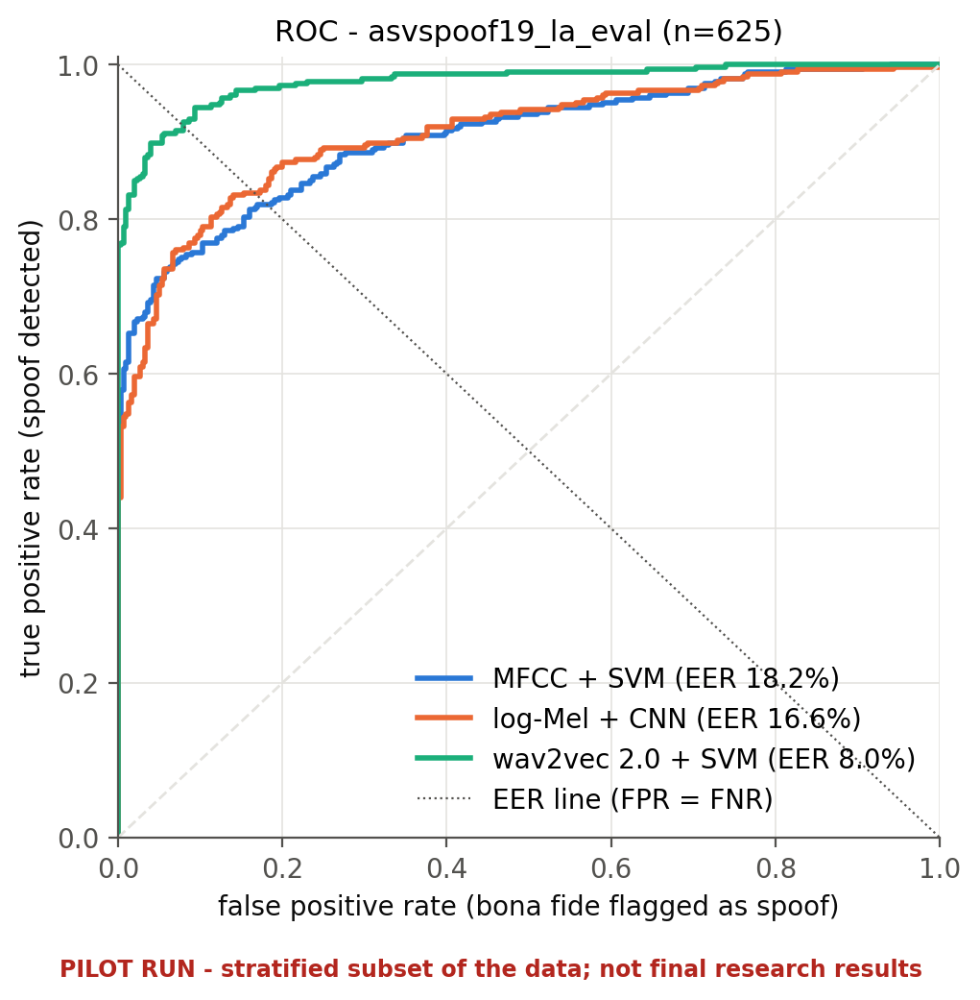
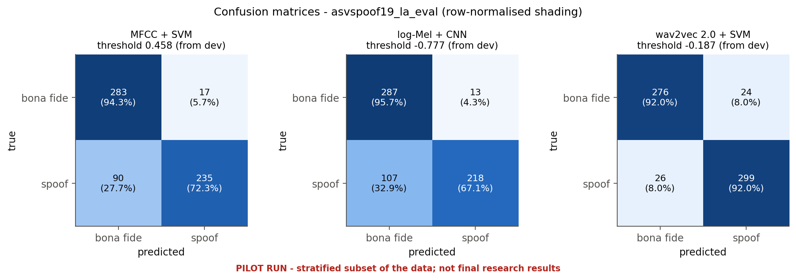
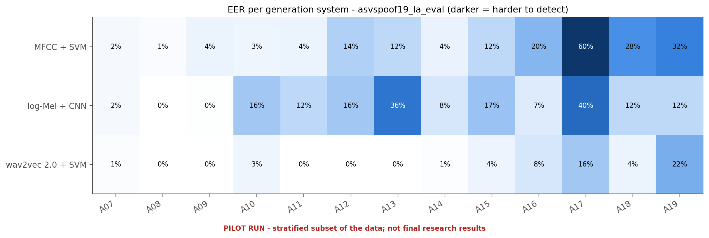

# Solution 1: MFCC Features + Support Vector Machine
### Classical Statistical Pattern Recognition Baseline

## 1. Overview

Mel-Frequency Cepstral Coefficients (MFCCs) represent important spectral characteristics of speech in a compact numerical form. They are widely used in speech-processing tasks and provide a practical starting point for conventional audio classification.

A Support Vector Machine (SVM) is a supervised learning algorithm that constructs a decision boundary between classes. In this approach, MFCC features extracted from each recording will be used to train an SVM to classify audio as genuine human speech or AI-generated/manipulated speech.

This solution serves as the classical baseline for comparison with the two deep-learning-based approaches.

## 2. Proposed Methodology

**Step 1: Audio Preprocessing**

Load the labelled recordings, convert them to mono where necessary, and standardize the sampling rate and duration. Apply consistent preprocessing to all three approaches.

**Step 2: MFCC Feature Extraction**

Extract MFCCs from successive audio frames. Calculate the mean and standard deviation of each coefficient across time to produce a fixed-length feature vector for each recording. Delta coefficients may be investigated as an optional extension.

**Step 3: Feature Scaling**

Standardize the feature vectors using statistics calculated from the training data only. Apply the same fitted transformation to the development and evaluation data.

**Step 4: Model Training**

Train an SVM, initially using a Radial Basis Function (RBF) kernel. Tune hyperparameters using the development set and consider class weighting to address the imbalance between genuine and spoofed recordings.

**Step 5: Classification**

Use the trained model to produce class predictions and decision scores for unseen recordings. Select any classification threshold using development data, not the final test set.

## 3. Evaluation

Use the same training, development, and final test partitions as Solutions 2 and 3.

Evaluation will include:
- Accuracy, precision, recall, and F1-score.
- Equal Error Rate (EER) and ROC-AUC.
- Confusion matrix and ROC curve.
- Feature-extraction and inference time.

Results will be reported separately for the benchmark and independent external test sets. The external test will examine whether the classifier remains effective when exposed to speech from unfamiliar generation systems.

## 4. Strengths and Limitations

**Strengths**
- Relatively low computational requirements.
- Fast training and straightforward implementation.
- Provides a clear example of feature vectors, supervised learning, statistical classification, and decision boundaries.

**Limitations**
- Temporal pooling may discard useful information about changes across speech frames.
- Handcrafted features may not capture every artifact introduced by modern speech-generation systems.
- Performance may deteriorate under unseen generators or altered audio conditions.

## 5. Expected Contribution

This solution will establish a reproducible conventional baseline. Its results will help determine how far compact, handcrafted acoustic features can support robust AI-generated speech detection.

## 6. Implementation and Results

> **Demo (pilot) run, 2026-10-25.** Trained on a stratified subset of ASVspoof 2019 LA (600 train / 600 dev clips) and tested on 625 LA eval clips (in domain) and 796 CD-ADD clips (external). These numbers demonstrate the pipeline and are **not** final research results. All values come from [results/final_report.md](../results/final_report.md), which is generated from the saved result files.

### 6.1 What was implemented

| item | setting |
|---|---|
| code | `src/speechdeepfake/features/mfcc.py`, `models/mfcc_svm.py`, `models/svm.py`, `training/train_svm.py` |
| features | 40 MFCCs (64 Mel bands, 512-point FFT, 25 ms window, 10 ms hop) → mean + std over time → **80-D** vector |
| classifier | `StandardScaler` (fitted on train only) → RBF `SVC`, `class_weight="balanced"` |
| tuning | grid C ∈ {0.1, 1, 10} × gamma ∈ {0.3, 1, 3} × sklearn "scale", selected by dev EER |
| selected | C = 10, gamma = scale; 277 support vectors; model file 187 kB |
| threshold | 0.4583 (dev EER point), reused unchanged on every test set |

### 6.2 Performance

| set | accuracy | balanced acc. | precision | recall | F1 | ROC-AUC | EER [95% CI] |
|---|---|---|---|---|---|---|---|
| development (tuning) | 85.67% | 85.67% | 85.67% | 85.67% | 85.67% | 0.933 | 14.33% |
| ASVspoof 2019 LA eval (in domain) | 82.88% | 83.32% | 93.25% | 72.31% | 81.46% | 0.906 | 18.15% [15.38, 21.32] |
| CD-ADD test (external) | 82.04% | 49.77% | 82.35% | 99.54% | 90.13% | 0.560 | 46.49% [42.96, 51.44] |

**Compared with the other solutions** (same records):

| | MFCC + SVM | log-Mel + CNN | wav2vec 2.0 + SVM |
|---|---|---|---|
| EER in domain | 18.15% | 16.62% | **8.00%** |
| EER external | **46.49%** | 47.86% | 57.14% |
| inference (ms / recording) | **4.2** | 5.5 | 145 |
| training (s) | **0.01** (+ 4.0 s features) | 196 | 0.04 (+ 88 s features) |

### 6.3 Generalization and robustness

- Hardest unseen attacks in domain: **A17 (60% EER)**, A19 (32%) and A18 (28%); A07–A11 stay below 5%.
- External CD-ADD: near chance (ROC-AUC 0.56). The dev threshold flags all 140 genuine recordings as spoof, so the 82% accuracy only reflects the 82% spoof share.
- Audio degradations (in domain): EER rises to 28.0% with moderate MP3, 21.9% with aggressive MP3, 20.3% narrowband and **31.3% with 20 dB noise**. The larger MP3 effect occurred at the *higher* bit rate, so on this subset the effect is not monotonic in bit rate.

### 6.4 Conclusion for Solution 1

The MFCC baseline is by far the cheapest model: a few milliseconds per file, and it trains in a fraction of a second. It reaches 18% EER on unseen ASVspoof attacks, but it is the weakest model in domain and does not transfer to the newer TTS systems in CD-ADD.

Full comparison with the other two solutions: [final report](../results/final_report.md), Sections 2 and 13–19.

## 7. References

1. Hamza, A. et al. (2022). "Deepfake Audio Detection via MFCC Features Using Machine Learning." IEEE Access, 10.
   https://doi.org/10.1109/ACCESS.2022.3231480

2. ASVspoof 2019. "Automatic Speaker Verification Spoofing and Countermeasures Challenge: Evaluation Plan."
   https://www.asvspoof.org/asvspoof2019/asvspoof2019_evaluation_plan.pdf