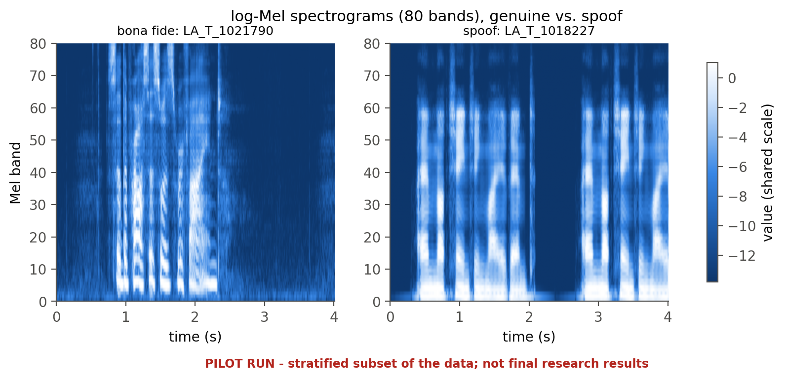
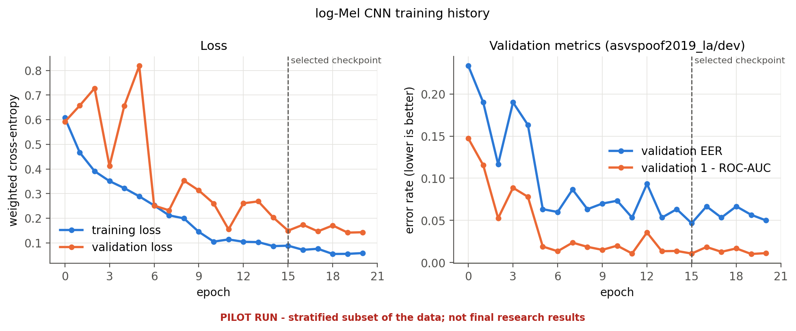
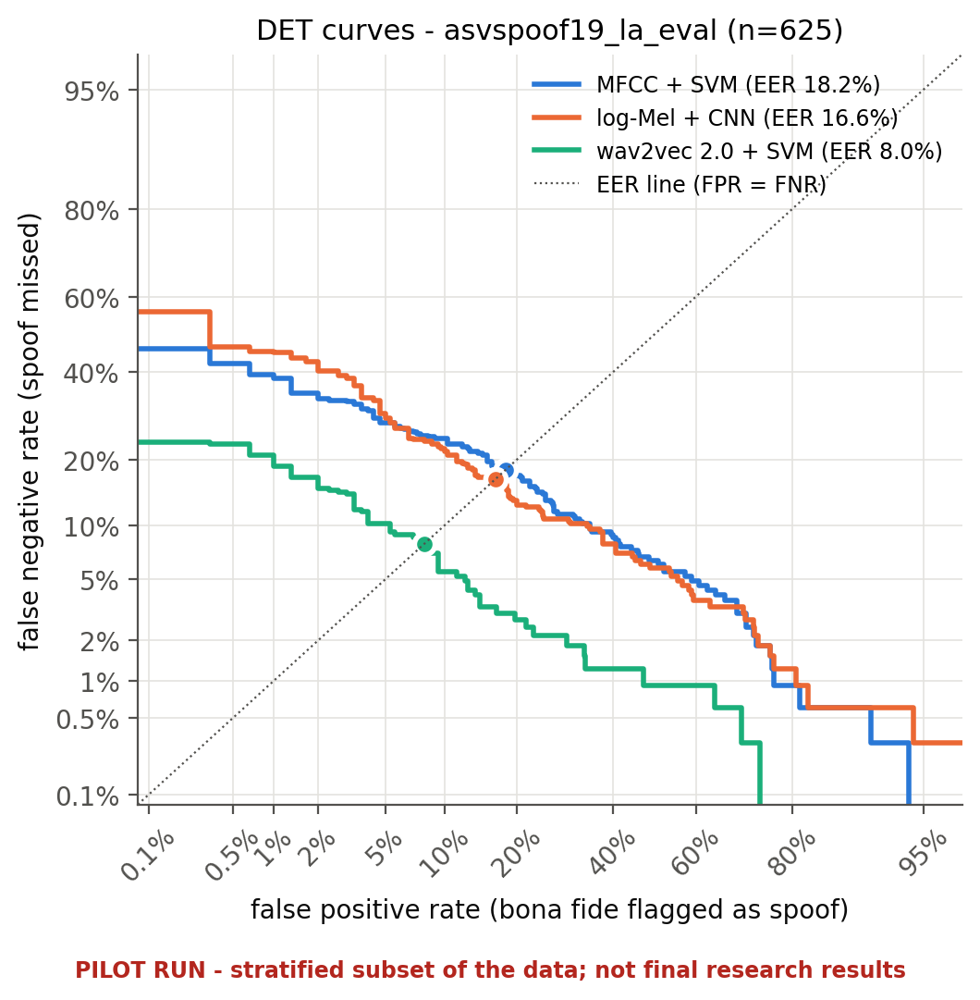
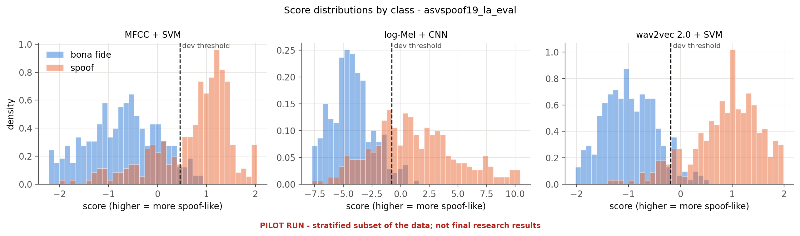
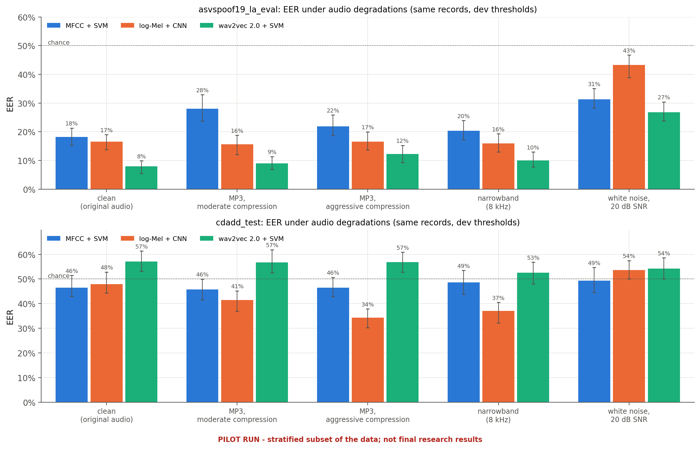

# Solution 2: Log-Mel Spectrogram + Convolutional Neural Network
### Learning Acoustic Patterns Through Deep Learning

## 1. Overview

A log-Mel spectrogram represents how audio energy is distributed across frequency bands over time. Unlike a compact summary of manually extracted features, it preserves time-frequency patterns that may help distinguish genuine speech from synthetic speech.

A Convolutional Neural Network (CNN) can learn discriminative patterns directly from spectrograms. This approach investigates whether a neural network trained on these representations can detect useful acoustic patterns that are not captured by the MFCC + SVM baseline.

## 2. Proposed Methodology

**Step 1: Audio Preprocessing**

Load and resample recordings consistently, convert them to mono where necessary, and handle variable durations using a documented cropping or padding strategy.

**Step 2: Log-Mel Spectrogram Generation**

Convert each waveform into a log-Mel spectrogram using fixed parameters for sample rate, window length, hop length, and number of Mel frequency bands. Normalize the inputs consistently using training-set statistics where applicable.

**Step 3: CNN Architecture**

Develop a compact CNN containing convolutional layers, nonlinear activation functions, pooling, and dropout. The network will learn features from the spectrogram and use a final classification layer to predict the genuine or synthetic class.

**Step 4: Model Training**

Train the CNN on labelled training recordings. Use the development set for hyperparameter tuning and early stopping. Apply class weighting if needed to address the class imbalance.

Any augmentation, such as moderate background noise or compression, must be restricted to training data and applied without creating overlap between training and evaluation sources.

**Step 5: Prediction**

Transform unseen recordings through the identical preprocessing and spectrogram pipeline before obtaining class predictions and decision scores.

## 3. Evaluation

Evaluate the CNN on exactly the same benchmark and external test recordings used for Solution 1.

Metrics will include:
- Accuracy, precision, recall, and F1-score.
- Equal Error Rate (EER) and ROC-AUC.
- Confusion matrix and ROC curve.
- Training time and inference time.

Visualizations will include representative genuine and synthetic speech spectrograms, training and validation learning curves, and comparative ROC curves for the three approaches.

## 4. Strengths and Limitations

**Strengths**
- Learns local time-frequency patterns automatically.
- Preserves more temporal and spectral information than pooled MFCC features.
- Provides useful visual material for understanding acoustic differences between recordings.

**Limitations**
- Generally requires more computation than the SVM baseline.
- May overfit to the specific datasets or generation systems used during training.
- High performance on familiar samples does not necessarily imply generalization to unseen systems.

## 5. Expected Contribution

This solution will examine whether learned spectrogram representations provide an advantage over handcrafted acoustic features and how the CNN behaves when evaluated on independent speech-generation systems.

## 6. Implementation and Results

> **Demo (pilot) run, 2026-10-25.** Trained on a stratified subset of ASVspoof 2019 LA (600 train / 600 dev clips) and tested on 625 LA eval clips (in domain) and 796 CD-ADD clips (external). These numbers demonstrate the pipeline and are **not** final research results. All values come from [results/final_report.md](../results/final_report.md), which is generated from the saved result files.

### 6.1 What was implemented

| item | setting |
|---|---|
| code | `src/speechdeepfake/features/logmel.py`, `models/logmel_cnn.py`, `training/train_cnn.py` |
| input | 80-band log-Mel spectrogram, 512-point FFT, 25 ms Hann window, 10 ms hop → **80 × 401** for 4 s; per-band standardisation from training clips |
| network | 4 × [Conv 3×3 → BatchNorm → ReLU → MaxPool 2×2], channels 16-32-64-128, global average pooling, dropout 0.3, linear 128 → 2; **97,650 parameters** (404 kB) |
| training | class-weighted cross-entropy, AdamW (lr 1e-3, wd 1e-4), ReduceLROnPlateau, early stopping (patience 5) on dev EER, max 30 epochs |
| selected | epoch 15 of 21 (best dev EER); score = z_spoof − z_bonafide; threshold −0.777 from dev |

### 6.2 Performance

| set | accuracy | balanced acc. | precision | recall | F1 | ROC-AUC | EER [95% CI] |
|---|---|---|---|---|---|---|---|
| development (checkpoint selection) | 95.17% | 95.17% | 95.32% | 95.00% | 95.16% | 0.989 | 4.67% |
| ASVspoof 2019 LA eval (in domain) | 80.80% | 81.37% | 94.37% | 67.08% | 78.42% | 0.911 | 16.62% [13.84, 18.98] |
| CD-ADD test (external) | 82.29% | 49.92% | 82.39% | 99.85% | 90.28% | 0.531 | 47.86% [44.31, 52.82] |

The jump from 4.7% dev EER to 16.6% eval EER is the clearest overfitting signal in the study. The dev set shares its attack algorithms (A01–A06) with training, while eval contains unseen attacks.

| | MFCC + SVM | log-Mel + CNN | wav2vec 2.0 + SVM |
|---|---|---|---|
| EER in domain | 18.15% | 16.62% | **8.00%** |
| EER external | **46.49%** | 47.86% | 57.14% |
| inference (ms / recording) | **4.2** | 5.5 | 145 |
| training (s) | **0.01** (+ 4.0 s features) | 196 | 0.04 (+ 88 s features) |

### 6.3 Generalization and robustness

- Hardest unseen attacks: **A17 (40%)**, A13 (36%) and A15 (17%); A08 is detected perfectly and A09 almost so (0.3%).
- External CD-ADD: near chance overall. YourTTS is the easiest external generator (24.6% EER) and Seamless the hardest (63.6%).
- Audio degradations (in domain): MP3 and narrowband leave the CNN's EER essentially unchanged (15.7–16.6%), but **20 dB white noise raises it to 43.3%**, the largest degradation of any model. Under moderate MP3 its balanced accuracy still falls to 54% at an unchanged EER. The scores shift past the dev threshold, which is a calibration effect.

### 6.4 Conclusion for Solution 2

The CNN learns time-frequency patterns that make it slightly better than MFCC + SVM on unseen ASVspoof attacks (16.6% vs. 18.2% EER, though the confidence intervals overlap) at similar inference cost. It is the model most sensitive to additive noise, and its dev-to-eval gap shows that it fits the training attacks closely.

Full comparison with the other two solutions: [final report](../results/final_report.md), Sections 2 and 13–19.

## 7. References

1. Gao, Y., Vuong, T., Elyasi, M., Bharaj, G., and Singh, R. (2021). "Generalized Spoofing Detection Inspired from Audio Generation Artifacts." Interspeech 2021, pp. 4184–4188.
   https://doi.org/10.21437/Interspeech.2021-1705

2. Li, Y. et al. (2024). "Cross-Domain Audio Deepfake Detection: Dataset and Analysis." EMNLP 2024.
   https://aclanthology.org/2024.emnlp-main.286/