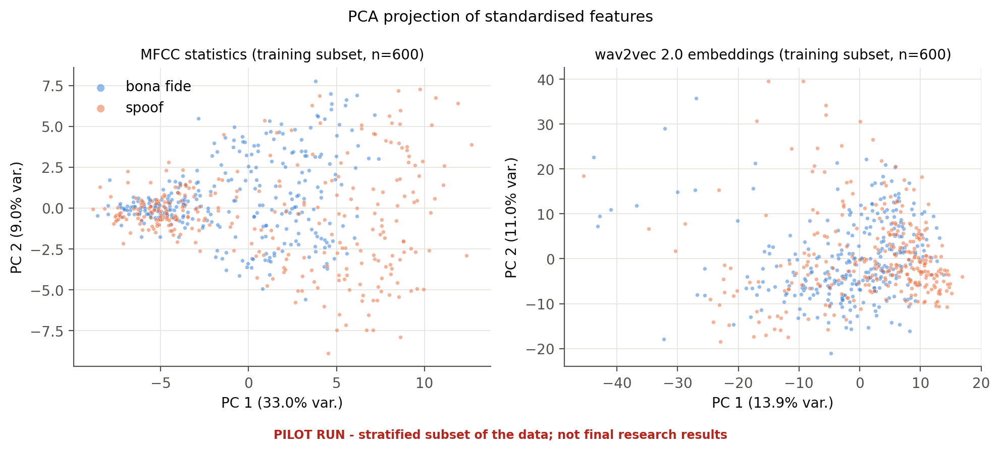
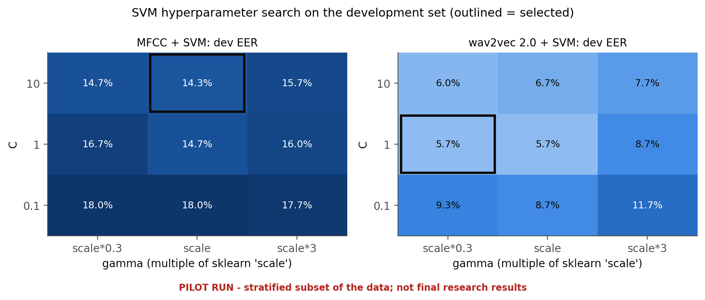
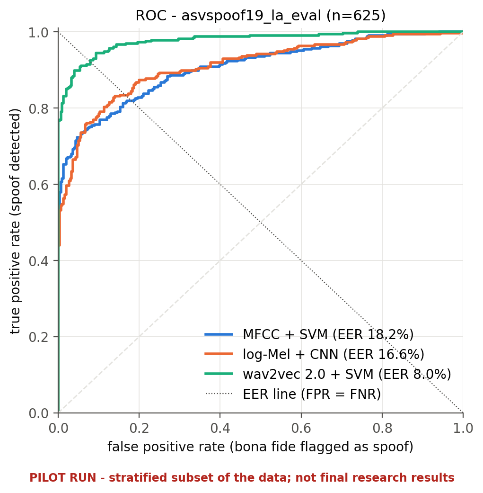
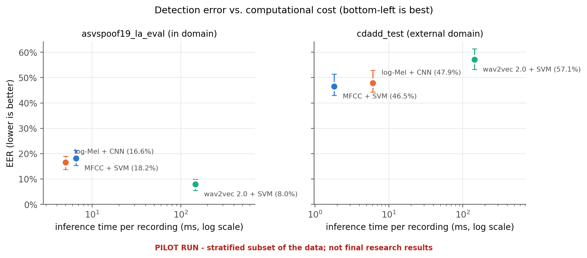
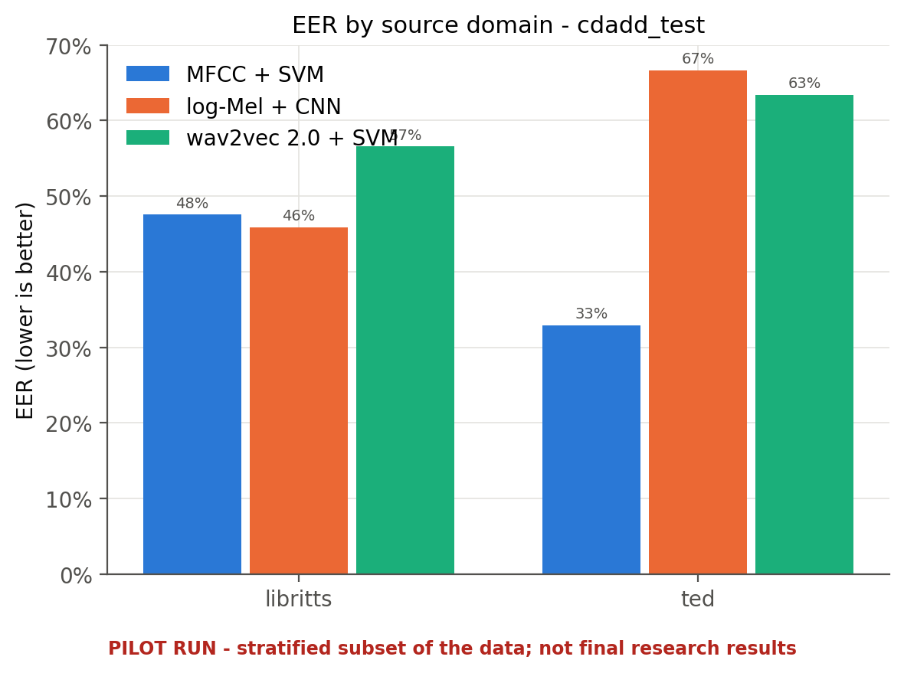

# Solution 3: Pretrained wav2vec 2.0 Embeddings + Support Vector Machine
### Transfer Learning with Frozen Speech Representations

## 1. Overview

wav2vec 2.0 is a self-supervised speech representation model designed to learn useful representations from large amounts of speech audio. It can provide learned features without requiring a new neural network to be trained from scratch for the classification task.

In this approach, a pretrained wav2vec 2.0 model will act as a frozen feature extractor. The representations obtained from its hidden layers will be aggregated into fixed-length embeddings, which will then be supplied to an SVM to classify recordings as genuine or AI-generated.

This method investigates whether pretrained speech representations offer useful information beyond the handcrafted features and spectrogram-based features used in Solutions 1 and 2.

## 2. Proposed Methodology

**Step 1: Audio Preprocessing**

Prepare recordings according to the pretrained model's requirements. The public `facebook/wav2vec2-base` checkpoint expects audio sampled at 16 kHz. Apply consistent duration handling and normalization.

**Step 2: Embedding Extraction**

Pass each waveform through the frozen pretrained model to obtain frame-level hidden representations. Apply mean pooling across time to produce a fixed-length embedding for each recording.

Cache the embeddings to avoid repeatedly running the pretrained model during SVM tuning.

**Step 3: Feature Scaling**

Standardize embeddings using statistics calculated from the training set only. Reuse the same transformation for development and test recordings.

**Step 4: SVM Training**

Train an SVM, initially with an RBF kernel, on the extracted embeddings. Tune the hyperparameters and classification threshold using the development set only.

**Step 5: Prediction**

Extract embeddings from unseen recordings using the same checkpoint and preprocessing pipeline. Use the trained SVM to obtain the final prediction and decision score.

## 3. Evaluation

Use the same training, development, and final test partitions as the other two solutions.

Evaluation metrics will include:
- Accuracy, precision, recall, and F1-score.
- Equal Error Rate (EER) and ROC-AUC.
- Confusion matrix and ROC curve.
- Embedding-extraction time, SVM inference time, and model-storage requirements.

An important limitation must be considered: the public wav2vec 2.0 base checkpoint was pretrained using LibriSpeech, while the public CD-ADD test package includes LibriTTS-derived recordings as well as TED-sourced recordings. Report results on a TED-sourced subset separately where the metadata permits, alongside the overall external-test result, to make potential source overlap transparent. Apply the same test subsets to all three approaches.

## 4. Strengths and Limitations

**Strengths**
- Uses representations learned from large amounts of speech audio.
- Avoids training a large feature-extraction network from scratch.
- Combines transfer learning with a relatively lightweight classical classifier.

**Limitations**
- Embedding extraction requires additional computation and storage.
- The pretrained representations may retain speaker-, language-, or dataset-specific characteristics.
- Strong speech representations do not guarantee strong synthetic-speech detection.
- Potential overlap between pretraining and evaluation sources must be documented.

## 5. Expected Contribution

This solution will test whether pretrained speech representations provide a useful balance between handcrafted acoustic features and a CNN trained directly on spectrograms. It will also examine whether any observed benefits persist on independent test recordings.

## 6. Implementation and Results

> **Demo (pilot) run, 2026-10-25.** Trained on a stratified subset of ASVspoof 2019 LA (600 train / 600 dev clips) and tested on 625 LA eval clips (in domain) and 796 CD-ADD clips (external). These numbers demonstrate the pipeline and are **not** final research results. All values come from [results/final_report.md](../results/final_report.md), which is generated from the saved result files.

### 6.1 What was implemented

| item | setting |
|---|---|
| code | `src/speechdeepfake/features/wav2vec_embeddings.py`, `models/wav2vec_svm.py`, `models/svm.py`, `training/train_svm.py` |
| backbone | `facebook/wav2vec2-base` (revision `0b5b8e86…`), frozen, eval mode, ~95 M parameters, not fine-tuned |
| embedding | last transformer layer, mean-pooled over valid frames → **768-D**, cached per recording |
| classifier | `StandardScaler` (train only) → RBF `SVC`, balanced class weights; same grid and dev-EER selection as Solution 1 |
| selected | C = 1, gamma = 0.3 × scale; 258 support vectors; SVM file 1.6 MB (plus the backbone) |
| threshold | −0.1869 (dev EER point) |

### 6.2 Performance

| set | accuracy | balanced acc. | precision | recall | F1 | ROC-AUC | EER [95% CI] |
|---|---|---|---|---|---|---|---|
| development (tuning) | 94.50% | 94.50% | 94.65% | 94.33% | 94.49% | 0.987 | 5.67% |
| ASVspoof 2019 LA eval (in domain) | **92.00%** | **92.00%** | 92.57% | **92.00%** | **92.28%** | **0.978** | **8.00% [5.55, 9.88]** |
| CD-ADD test (external) | 81.03% | 49.44% | 82.25% | 98.17% | 89.51% | 0.392 | 57.14% [53.19, 61.33] |

| | MFCC + SVM | log-Mel + CNN | wav2vec 2.0 + SVM |
|---|---|---|---|
| EER in domain | 18.15% | 16.62% | **8.00%** |
| EER external | **46.49%** | 47.86% | 57.14% |
| inference (ms / recording) | **4.2** | 5.5 | 145 |
| training (s) | **0.01** (+ 4.0 s features) | 196 | 0.04 (+ 88 s features) |

In domain, wav2vec 2.0 + SVM is the only model whose confidence interval does not overlap those of the other two. It misses 26 spoofs, against 90 for MFCC and 107 for the CNN.

### 6.3 Generalization, source overlap and robustness

- In domain: 0% EER on 5 of the 13 unseen attacks (A08, A09, A11, A12, A13); the hardest are **A19 (21.7%)** and A17 (16.0%).
- External CD-ADD: ROC-AUC **0.39 (below chance)**, i.e. genuine CD-ADD speech scores as *more* spoof-like than the TTS speech. By source domain the EER is 56.6% on LibriTTS and 63.4% on TED, so in this run the LibriSpeech pretraining domain did **not** give the model an advantage on the LibriTTS subset.
- Audio degradations (in domain): small EER increases for MP3 (+1.0 / +4.3 pp) and narrowband (+2.0 pp). 20 dB noise raises the EER to 26.8%, and the dev threshold then labels every recording one class (balanced accuracy 50%).

### 6.4 Conclusion for Solution 3

Frozen self-supervised representations give the best in-domain detector by a wide margin: 8.0% EER against 16.6–18.2%, with a training cost of seconds once embeddings are cached. The price is roughly 30× the inference time of the other models. They also generalise worst to the new TTS systems in CD-ADD: here, strong speech representations did not translate into cross-domain deepfake detection.

Full comparison with the other two solutions: [final report](../results/final_report.md), Sections 2 and 13–19.

## 7. References

1. Baevski, A., Zhou, Y., Mohamed, A., and Auli, M. (2020). "wav2vec 2.0: A Framework for Self-Supervised Learning of Speech Representations." Advances in Neural Information Processing Systems 33.
   https://papers.neurips.cc/paper_files/paper/2020/hash/92d1e1eb1cd6f9fba3227870bb6d7f07-Abstract.html

2. Meta AI. "facebook/wav2vec2-base: Model Card."
   https://huggingface.co/facebook/wav2vec2-base

3. Li, Y. et al. (2024). "Cross-Domain Audio Deepfake Detection: Dataset and Analysis."
   https://aclanthology.org/2024.emnlp-main.286/